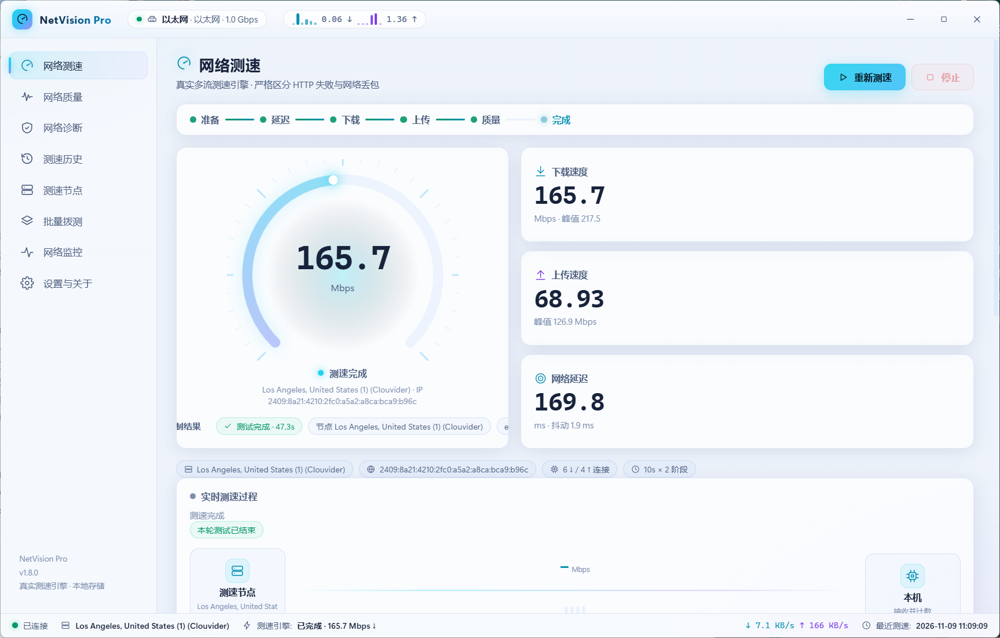
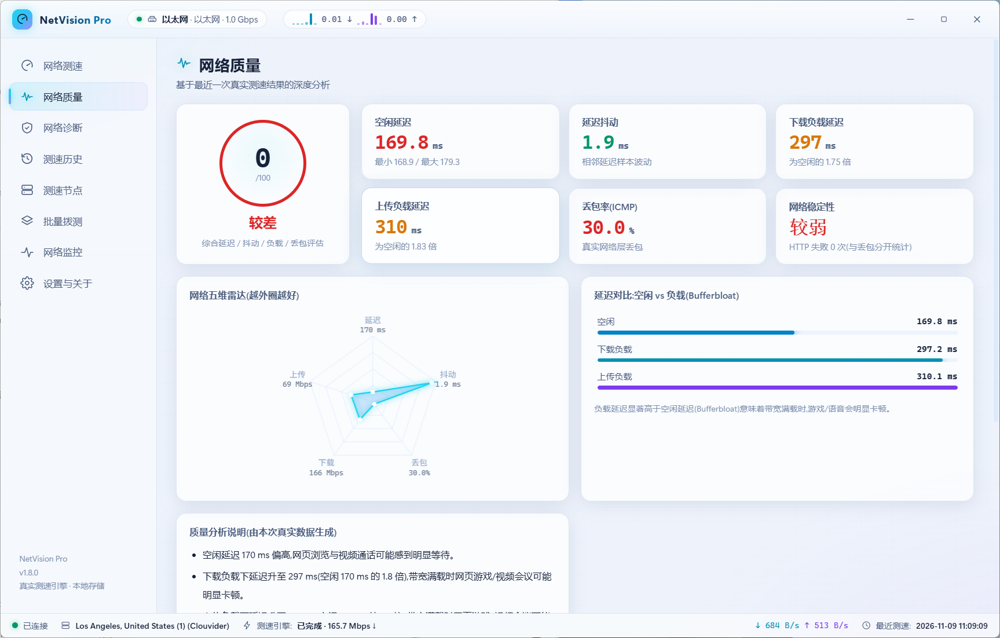
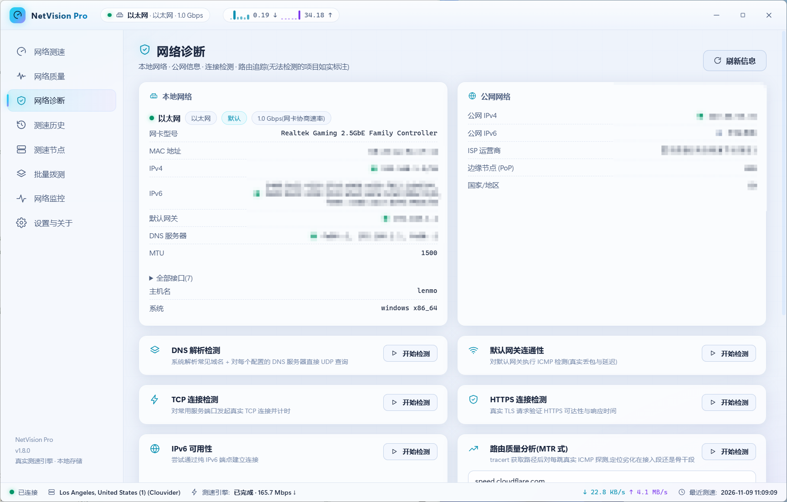
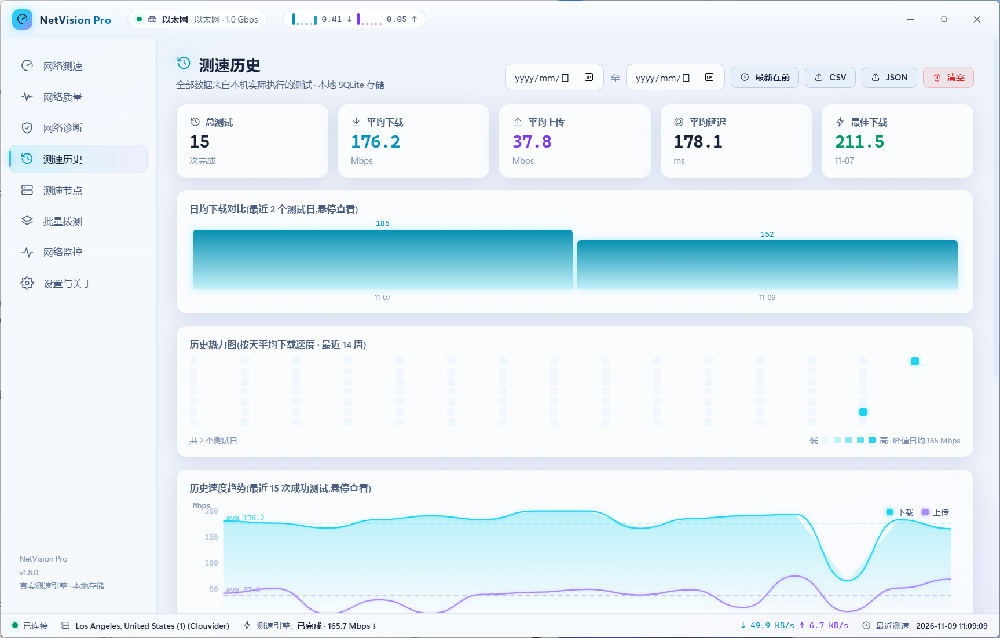
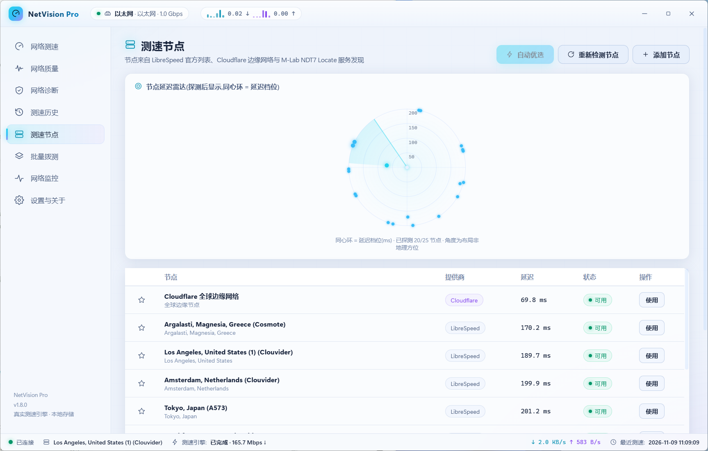
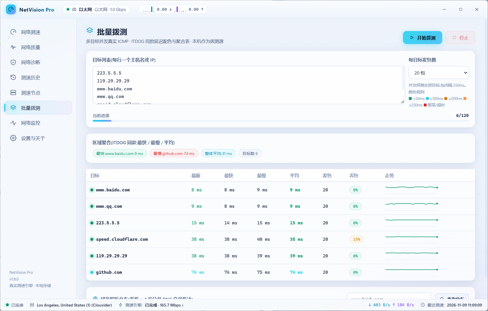

# NetVision Pro

[](https://github.com/yuchen0x1/Internet-Speed-Test/actions/workflows/ci.yml) [](https://github.com/yuchen0x1/Internet-Speed-Test/releases/latest) [](LICENSE)

**专业级 Windows 桌面网络测速与诊断工具**

NetVision Pro 面向需要了解真实网络质量的个人用户、开发者和运维人员。应用内测量由本机 Rust 引擎完成，结果进入本地 SQLite 历史库，不使用模拟数据。

[下载最新安装包](https://github.com/yuchen0x1/Internet-Speed-Test/releases/latest) · [查看 Releases](https://github.com/yuchen0x1/Internet-Speed-Test/releases)

## 最新更新

### v1.12.0 · 2026-11-13

- 历史统计覆盖整个日期范围，新增今天、近 7/30 天筛选，CSV/JSON 沿用当前筛选与排序。
- 修复测速结果保存与界面刷新、节点增删、并发设置、监控状态恢复等问题。
- 取消测速不再显示完整评级；未知丢包和上传结果保持未知，多次配置损坏保留已有备份。
- 支持自动检查稳定版更新、查看发布说明与下载字节进度，并要求更新包签名绑定版本号。

完整版本历史见 [发布说明](docs/releases/release-notes.md)。

## 界面预览

以下为已有脱敏运行素材，关于页显示 v1.8.0；用于展示布局，不作为 v1.12.0 的验收证据。

| 真实测速 | 网络质量 |
| --- | --- |
|  |  |

| 网络诊断 | 测速历史 |
| --- | --- |
|  |  |

| 测速节点 | 批量拨测 |
| --- | --- |
|  |  |

更多运行记录见 [截图目录](docs/screenshots/) 和 [最终验证报告](docs/verification-report.md)。

## 功能

### 真实测速

- 多流并发测量延迟、下载、上传和质量指标。
- 支持 LibreSpeed HTTP、Cloudflare Speed 和 M-Lab NDT7 WebSocket。
- 自动探测节点，也可以在节点页添加自定义 HTTPS LibreSpeed 节点。
- 实时速度曲线、阶段事件链、累计数据和可取消的测速过程。
- 质量分析综合延迟、抖动、Bufferbloat、ICMP 丢包和 HTTP 失败，并生成解释性结论。

### 诊断、拨测与监控

- 网卡、网关、DNS、TCP、HTTPS、IPv6、ICMP、路由追踪和 NAT 检测入口。
- 多目标批量 ICMP 拨测、最快/最慢/平均聚合、目标走势和 DNS 解析分布。
- 网卡真实收发速率监控，支持 1/5/15/60 分钟窗口和连续 Ping 监测。
- 服务连通性矩阵、网络质量雷达和本地网络信息展示。

### 历史与系统集成

- SQLite 本地历史：日期筛选、排序、趋势图、热力图和详情回放。
- 日期筛选包含结束日期全天，支持今天、近 7/30 天快捷范围；CSV/JSON 沿用当前筛选与排序。
- 统计卡汇总整个筛选范围，失败/取消不计入速度均值，缺失上传结果显示未知；图表单独标明已加载范围。
- CSV、JSON 和 HTML 报告导出，支持历史保留策略。
- 计划测速、网络断开/恢复通知、托盘操作和本地 Prometheus `/metrics` 端点。
- CLI 与桌面端复用同一测速引擎，可输出完整 JSON。

历史可信度与测速状态改进的研究依据、文件说明及验收边界见 [升级报告](docs/evolution-2026-11-13.md)。

后续发现并修复的设置、节点、订阅、监控和质量分析问题，以及仍待改进的地方，见 [二次 Bug 复查](docs/recheck-2026-11-13.md)。

本机测速截图与原始测试数据保留在本地，不随源码或安装包发布。

### 官方测速入口

应用内提供固定白名单的国内外测速站入口，包括 SpeedTest.cn、运营商测速入口、Ookla Speedtest、FAST.com 和 Cloudflare Speed。入口交给系统浏览器打开，第三方网站结果不会写入 NetVision Pro 历史，也不会被应用抓取或代跑。

## 下载与安装

- **系统**：Windows 10/11 x64。
- **运行依赖**：Windows WebView2；Windows 10/11 通常已预装。
- **安装包**：在 [Releases](https://github.com/yuchen0x1/Internet-Speed-Test/releases) 下载 `NetVision.Pro_1.12.0_x64-setup.exe`。
- **安装模式**：Tauri NSIS `currentUser`，默认按当前用户安装，不需要管理员权限。
- **WebView2 安装**：安装器使用 `downloadBootstrapper` 模式，在缺少运行时的环境中引导安装。
- **应用内更新**：v1.11.0 起可在「设置与关于 → 关于」点击「检查更新」下载并安装新版本（更新包经 minisign 签名校验，安装完成后自动重启）。

## 快速开始

1. 安装并启动 NetVision Pro。
2. 在“网络测速”页确认自动优选节点，点击“重新测速”。
3. 等待延迟、下载、上传和质量阶段完成。
4. 在“网络质量”页查看 Bufferbloat、抖动和丢包分析。
5. 需要排查链路时进入“网络诊断”；需要长期观察时进入“网络监控”。
6. 在“测速历史”页筛选记录或导出 CSV/JSON/HTML 报告。

页面说明和操作示例见 [使用指南](docs/usage.md)。

## 文档导航

- [使用指南](docs/usage.md)：按页面说明测速、诊断、拨测、监控、导出和 CLI。
- [配置与数据](docs/configuration.md)：数据目录、默认设置、隐私开关和 Prometheus。
- [故障排查](docs/troubleshooting.md)：启动、测速、节点、DNS、IPv6、导出和 CLI 问题。
- [自动更新](docs/AUTO_UPDATE.md)：更新检查、签名发布、GitHub Secrets、测试与失败处理。
- [贡献指南](CONTRIBUTING.md)：开发环境、验证命令、代码约定和 PR 要求。
- [路线图](ROADMAP.md)：已完成能力与后续规划，规划项不等同于当前版本功能。
- [最终验证报告](docs/verification-report.md)：真实运行页面、截图、构建和测试记录。

## CLI

安装后可以在应用目录运行 CLI。它和桌面端使用同一测速引擎，并默认复用同一应用数据目录。

```powershell
.\netvision-pro.exe cli speedtest --json --duration 10 --down 6 --up 4
```

常用参数：

```text
--node <url>     手动指定 HTTPS 测速节点
--precision      使用更高精度的延迟采样
--no-save        不写入本地历史
```

进度和阶段事件写入 `stderr`，结果写入 `stdout`；`--json` 返回完整结果对象。退出码为：`0` 完成、`1` 参数错误、`2` 已取消、`3` 测速失败。

## 测量口径

1. 检查网络接口，合并在线节点、内置兜底节点和 Cloudflare 边缘节点，并对候选节点进行延迟与下载能力探测。
2. 延迟使用多次 HTTP 往返样本，报告中位数、最小值、最大值和抖动。
3. 下载与上传均使用真实多流传输和流式字节计数；网卡协商速率只作为系统信息展示，不会当作宽带测速速度。
4. 质量阶段并行测量负载延迟和 ICMP 丢包；HTTP 请求失败与网络丢包分开统计。
5. 速度统一按字节/秒计算：`Mbps = bytes × 8 / 1e6`。
6. NDT7 的延迟是 WebSocket 握手时延近似值，不等同于 ICMP 或 HTTP Ping。

## 数据、隐私与安全

- 应用设置、历史和诊断数据默认只保存在本机。
- 公网 IP/ISP 仅在用户开启设置后查询，并使用测速同源服务。
- NDT7 Locate 访问令牌只在 Rust 适配器运行时内存中使用，不进入前端状态、CLI JSON 或历史记录。
- 外部测速站只允许固定服务 ID 和固定 HTTPS 地址；应用不接受任意 URL，不抓取网页，不上传测速数据。
- 目标主机禁用 ICMP 时显示未知，不伪造为 0% 丢包。
- 数据目录、默认设置、Prometheus 端点和清理策略见 [配置说明](docs/configuration.md)。

## 开发与构建

开发环境：Windows、Node.js 20.9+、Rust 1.80+（MSVC 工具链）、Windows WebView2。

```bash
npm ci
npm run icons
npm run typecheck
npm run test
npm run build
cargo test --locked --manifest-path src-tauri/Cargo.toml
npm run tauri build
```

开发运行：

```bash
npm run dev
npm run tauri dev
```

NSIS 安装包输出到：

```text
src-tauri/target/release/bundle/nsis/
```

### 签名发布构建（自动更新用）

`npm run tauri build` 产出的是不带更新签名的普通安装包。带签名的构建用于发布：push `v*` 标签时由 CI（`.github/workflows/release.yml`）自动完成，签名私钥来自 repo secrets。本地手动执行签名构建可用：

```bash
npm run build:release
```

该脚本从 `~/.tauri/netvision-pro-updater.key`（及同名 `.password` 文件）读取 minisign 私钥，通过 `src-tauri/updater.conf.json` 启用 `createUpdaterArtifacts`，产出安装包与 `.sig` 签名文件。也可以自行设置 `TAURI_SIGNING_PRIVATE_KEY` / `TAURI_SIGNING_PRIVATE_KEY_PASSWORD` 后运行：

```bash
npm run tauri -- build --bundles nsis --config src-tauri/updater.conf.json
```

真实网络集成用例默认标记为 `#[ignore]`，需要时显式执行：

```bash
cargo test --locked --manifest-path src-tauri/Cargo.toml -- --ignored
```

## 已知限制

- 节点质量、运营商线路、Wi-Fi 信号和本地防火墙会影响结果；受限网络建议添加可访问的本地 LibreSpeed HTTPS 节点。
- 某些目标或中间设备禁用 ICMP 时，丢包和 Ping 结果可能为未知。
- Cloudflare 元信息接口在部分网络中不会返回 ISP，使用 Cloudflare 节点时 ISP 可能显示未知。
- 自适应分块上传在块间隙可能出现脉冲状曲线，上传均值使用稳定窗口计算。
- Wi-Fi 信号强度依赖 Windows `netsh wlan` 和网卡驱动，部分设备可能显示硬件不支持。
- NDT7 节点可用性取决于 Locate 服务和目标实验节点；自动优选可能选择其他可用协议节点。

更多排障建议见 [故障排查](docs/troubleshooting.md)。

## FAQ

### 为什么测速结果和网卡标称速率不同？

网卡协商速率只是本地链路能力，测速结果来自目标节点的真实端到端传输；服务器、运营商线路、Wi-Fi 和本地负载都会影响结果。

### 为什么 ICMP 丢包和网页访问结果不一致？

ICMP 可能被目标主机或中间设备限速、丢弃。应用把 HTTP 失败和 ICMP 丢包分开统计，因此应结合 HTTPS、TCP 和测速结果判断。

### 如何提高受限网络下的测速代表性？

在“测速节点”页添加本地或运营商附近的 LibreSpeed HTTPS 节点，或先重新检测节点再使用自动优选。不同协议和节点的结果不能直接当作同一链路基准。

### 历史数据保存在哪里？

默认保存于 `%APPDATA%\\com.netvisionpro.app`，具体文件和重置方式见 [配置与数据](docs/configuration.md)。

### 能否让其他机器访问 Prometheus？

不能直接访问。内置端点只监听 `127.0.0.1`，这是为了避免将本机网络指标暴露到局域网；如需集中采集，应在本机部署受控的采集转发方案。

## 安全修复

当前前端图标构建依赖 `sharp@0.35.5`。本轮本机 npm audit 查询受网络阻断，不能据此声称零漏洞；Rust 审计退出码为 0，但保留 5 项维护性/unsound 警告。测试与审计边界见 [复查报告](docs/recheck-2026-11-13.md)。更新包使用 minisign 校验及签名版本绑定；Windows 安装器目前没有 Authenticode 证书签名，两者用途不同。

## 贡献

欢迎提交问题、测试反馈和代码改进。请先阅读 [贡献指南](CONTRIBUTING.md)，确认变更范围后再提交 Issue 或 Pull Request。

## 许可证

[MIT License](LICENSE)

部分动效与可视化模式复用了 [Caho1/open-claude-ui](https://github.com/Caho1/open-claude-ui) 的 MIT 许可实现，详见源文件说明。
