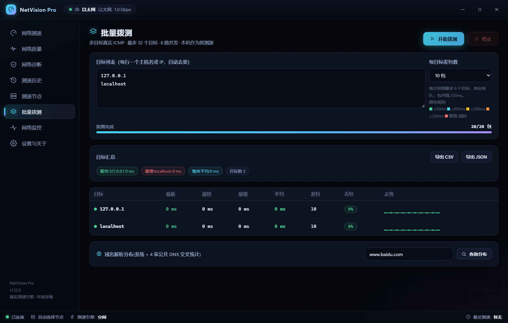

# NetVision Pro：拨测与监控指标升级验收

本报告记录开发阶段；相关改动已随 [v1.13.0](releases/release-notes.md#v1-13-0) 发布，最终发布与签名结果见 [发布验证](releases/verification-v1.13.0.md)。

日期：2026-11-13。基线：`main` / `d2b3a9d`，开始时工作区干净。本轮仅作本地修改，没有提交、推送、标签、发布或安装。

## 项目认知与执行范围

Windows 10/11 x64 桌面网络工具；React 19、TypeScript、Zustand、Vite 前端，Rust、Tokio、Tauri 2 后端；SQLite 保存测速/诊断历史，JSON 保存设置。没有应用服务端、账号或云数据库。

| 模块 | 实际落点与现状 | 本轮处理 |
| --- | --- | --- |
| 测速/质量 | `engine/`、`store/test.ts`、SpeedTest/Quality 页面；已有 LibreSpeed/Cloudflare/NDT7、取消和质量分析 | 保留引擎并运行已有回归，未重测全部公网节点 |
| 诊断 | `diagnostics.rs`、Diagnostics 页面；已有 DNS、ICMP、TCP、HTTPS、IPv6、路由、NAT | 源码检查和回归，真实公网用例仍按需执行 |
| 节点/设置 | selector、settings、Servers 页面；已有优选、收藏、自定义节点和原子保存 | 保留已有实现，无重复开发 |
| 历史 | storage、History 页面；已有日期筛选、分页、统计和导出 | 复用读取契约，无迁移、无用户数据清理 |
| 拨测 | batchtest、batch store、BatchTest 页面；已有测量，缺任务身份/恢复和导出 | 本轮重点补齐 |
| 监控/自动化 | monitor、pingmon、scheduler、托盘；已有实时采样、计划测速和通知 | 保留；高频历史容量继续列为待办 |
| 指标/更新 | prometheus、设置页、发布工作流 | 修复指标；更新通道保持原实现，不宣称完成真实更新验收 |

项目识别、Git 基线、关键源码、5 个开源项目研究、实现、回归与文档同步均已执行。这里是有证据的模块审计，不代表所有代码、平台和异常路径均无缺陷。

## 开源研究与许可证

读取官方 README、许可证标识及以下源文件。匿名 GitHub API 返回限流后，改读原始源码，Netronome 还检查了官方源码归档。没有运行竞品代码或移植代码，没有新增应用依赖；没有仅凭星数推断维护质量。

| 项目 | 具体阅读材料 | 借鉴与落地 |
| --- | --- | --- |
| [gping](https://github.com/orf/gping) · MIT | [main.rs](https://github.com/orf/gping/blob/master/gping/src/main.rs)、[plot_data.rs](https://github.com/orf/gping/blob/master/gping/src/plot_data.rs)、LICENSE | 真实时序与超时缺失值；拨测小图在超时处断开并标红，未测目标保持未知 |
| [MySpeed](https://github.com/gnmyt/MySpeed) · MIT | README、[Prometheus 路由](https://github.com/gnmyt/MySpeed/blob/development/server/routes/prometheus.js) | Gauge 和错误结果检查；只从成功测速生成速度指标，缺失上传不补零 |
| [Netronome](https://github.com/autobrr/netronome) · GPL-2.0-or-later（所读源文件） | README、go.mod、[packetloss.go](https://github.com/autobrr/netronome/blob/main/internal/speedtest/packetloss.go)、[监控文档](https://github.com/autobrr/netronome/blob/main/documentation/src/content/docs/monitoring/packet-loss.md) | 任务身份、取消上下文、进度与并发管理；自行实现并通过并发测试，不复制 GPL 代码 |
| [Speedtest Tracker](https://github.com/alexjustesen/speedtest-tracker) · MIT | README、[routes/api.php](https://github.com/alexjustesen/speedtest-tracker/blob/main/routes/api.php)、[GetLatestController](https://github.com/alexjustesen/speedtest-tracker/blob/main/app/Http/Controllers/Api/V0/GetLatestController.php) | 兼容接口、显式失败状态与时区；保留旧拨测契约，新增快照，修正时间输出 |
| [LibreSpeed](https://github.com/librespeed/speedtest) · LGPL-3.0 | README、LICENSE、[speedtest_worker.js](https://github.com/librespeed/speedtest/blob/master/speedtest_worker.js) | 区分开始、进行、完成与中止；拨测停止独立展示，未发出的包不补为丢包，不复制 LGPL 代码 |

Netronome 所读文档与源码对部分并发路径的描述并不完全一致。本项目通过自身测试确认限制，未把竞品配置项存在当作效果证据。指标设计另参考 [Prometheus exporter 指南](https://prometheus.io/docs/instrumenting/writing_exporters/)。

| 对比维度 | 原有情况/不足 | 本轮升级 |
| --- | --- | --- |
| 核心功能 | 测量已实现，重载丢状态 | 后端快照恢复最近一轮拨测 |
| UI 设计 | 超时仍连线，未测目标易误读 | 超时断线、排队/未探测状态、表单标签和 ARIA 进度 |
| 用户体验 | 开始响应后清样本，混用目标数与包数 | 先订阅、忙碌保护、真实包数进度和取消结果保留 |
| 技术架构 | 无编号事件、无并发预算 | run_id/revision、输入限制、8 路探测 |
| 自动化 | 指标混入失败值、时区和 Counter 口径错误 | 最近成功值、分类 Gauge、准确 HTTP 错误 |
| 扩展能力 | 结果仅在前端内存 | 后端快照与 CSV/JSON，不引入新服务 |

## 升级优先级与实现

| 优先级 | 问题/机会 | 价值与风险 | 结果 |
| --- | --- | --- | --- |
| P0 | 早到样本丢失、旧事件污染下一轮 | 结果可信度；前后端状态改动风险中等 | 任务编号、快照合并和先订阅后启动 |
| P0 | 重复/非法目标、无界目标并发 | 避免错误统计和资源突增；输入行为有意收紧 | 归一化去重、非法输入整批拒绝、32 个目标上限 |
| P1 | 错误指标、时区与历史计数类型 | 避免监控误报；Grafana 查询需复查 | 最近成功值、本地时区、存量 Gauge |
| P1 | 拨测不能导出与恢复 | 排障留证；只保留最近一轮进程内快照 | 快照 IPC、CSV/JSON 与取消结果导出 |
| P2 | 超时连线、状态与标签不足 | 低风险体验改进 | 空/错/排队/取消状态，标签与进度条语义 |
| P2 | Vite 监视 WebView 文件导致 EBUSY | 开发和隔离验收稳定性 | 排除本地测试产物目录 |
| P2/P3 | 高频历史分桶、全范围图表、多语言、远端探测/插件 | 需要独立设计、性能或基础设施验证 | 列入后续，不强行添加 |

拨测最多 256 输入行、32 个不同目标、8 个异步探测目标，单次探测等待上限 5 秒，每目标 1–100 包（界面提供 10/20/50）。按大小写、域名末尾点和 IP 标准形式去重；输入必须是主机名或 IP，不能带协议、路径或端口。有非法输入时整批拒绝。运行中再次启动报忙，停止后等待收尾才能重新开始。

新增 `batchtest://update` 和 `batchtest_snapshot`，含任务编号、修订号、状态和真实样本。事件按目标增量传输，快照返回完整结果；前端按任务及每目标发包数合并，延迟快照不回滚新结果。旧 start/stop/running 命令与 tick/target_done/all_done 事件的参数/返回形状保留。拒绝重叠任务、输入限制与去重是有意的行为变化。

切页/重载 WebView 可恢复最近一轮，完全退出应用不持久化拨测。CSV 包含时间、状态、目标、计划/实际包数、指标与完整样本；JSON 包含完整快照。导出检查后端 run_id 和结束状态，不接受可编辑前端结果。未测目标延迟/丢包留空，超时样本为 null；CSV 复用既有转义和公式中和。没有数据库迁移。

异步取消不能强行终止已进入 OS 的阻塞 DNS/ICMP 调用；稍后返回的结果不再写入本轮。8 路是应用异步探测任务上限，不能等同于 OS 线程压力验收。

Prometheus 变化：

- 持锁读取状态计数及最近成功结果，失败/取消不会覆盖速度值；连续失败时保留上次成功值，使用 timestamp 判断新鲜度。
- 保留 `netvision_tests_total` 名称及现存全部历史条数含义，TYPE 从 counter 修正为 gauge，HELP 不再声称全是完成记录。删除/保留策略会使它下降，不要使用 rate/increase。
- 新增 `netvision_history_completed/failed/cancelled` Gauge，均为现存条数。未知上传/丢包不补零。
- 旧本地时间按本地时区转 Unix 秒，支持带偏移 RFC3339；无法解析或夏令时歧义时省略 timestamp。
- 精确匹配 GET `/metrics`（允许查询串）。404 错误路径、405 非 GET、400 坏请求、408 超时、431 超大头、503 存储错误。
- 接收分段请求头，头上限 8KiB，读头 2 秒、整体 5 秒；仅绑定回环，最多 16 个连接处理任务，超额连接直接关闭。
- 旧监听退出不会覆盖新监听状态，绑定失败保留 requested 状态便于提示与重试。

## 主要文件清单

| 文件 | 修改原因 |
| --- | --- |
| `src-tauri/src/batchtest.rs` | 校验、并发/取消、任务快照与回归 |
| `src-tauri/src/commands.rs`、`lib.rs` | 快照/导出命令、CSV 与注册 |
| `src-tauri/src/prometheus.rs`、`storage.rs` | 指标、时区、HTTP、持锁聚合与共用行映射 |
| `src/store/batch.ts`、`src/api.ts`、`src/types.ts` | 契约、事件隔离、错误重试与恢复 |
| `src/pages/BatchTestPage.tsx` | 真实包进度、状态、导出、超时断线与标签 |
| `src/store/batch.test.ts`、`src/pages/BatchTestPage.test.tsx` | 竞态、旧事件、重载、失败和 DOM 交互 |
| `vite.config.ts` | 排除本地产物，防 Windows 文件锁 |
| README、使用/配置文档、路线图、两份更新日志 | 同步真实能力、兼容说明与验收边界 |
| `docs/screenshots/batch-lifecycle-verified.png` | 本轮原生应用真实回环测速截图 |

没有删除已有源文件、配置、数据库或历史。临时源码副本、研究归档和审计结果保存在忽略目录 `.evolution/`，不进入产品包。

后续目录维护说明（2026-11-13）：临时源码副本、浏览器缓存、下载归档和一次性脚本已移入回收站；隔离数据库/设置、原始 CSV/JSON 导出与审计结果仍保留在本地。下述记录说明验收时的行为，不要求缓存和脚本长期留存。

## 验证与边界

| 检查 | 状态 | 结果 |
| --- | --- | --- |
| `npm run typecheck` | PASS | 退出 0；最终 build 也包含类型检查 |
| `npm test` | PASS | 11 文件、67 项通过 |
| `npm run build` | PASS | 生产构建退出 0，保持按页拆包，无新运行依赖 |
| `npm run tauri -- build --no-bundle` | PASS | Windows 优化可执行文件构建完成；未生成/安装 NSIS 包 |
| `cargo fmt --manifest-path src-tauri/Cargo.toml -- --check` | PASS | 退出 0 |
| `cargo clippy --locked --manifest-path src-tauri/Cargo.toml --all-targets -- -D warnings` | PASS | 退出 0 |
| `cargo test --locked --manifest-path src-tauri/Cargo.toml` | PASS | 77 通过，4 个真实网络用例默认忽略 |
| `cargo test --locked --manifest-path src-tauri/Cargo.toml loopback_uses_real_icmp_pipeline -- --ignored --nocapture` | PASS | 新增真实 Windows 回环 ICMP 单独执行，1 项通过 |
| 原生窗口/IPC/页面 | PASS（限定场景） | 2 个去重目标 × 10 包均收到；切页保持；停止保留 2 包；重载恢复同一任务；观察区间无未捕获异常 |
| CSV 原生保存/文件 | PASS | 核对本轮时间、cancelled、2 个目标各 1 个真实样本；归档 `.evolution/native/result.csv` |
| JSON 原生保存/文件 | PASS（隔离默认目录） | 原生 Save 按钮保存 `.evolution/native/netvision_batch.json`；解析并核对完成状态、1 个目标及 1 个真实回环样本 |
| Prometheus TCP/故障注入 | PASS（隔离库） | 分段请求 200、移除内存库表后 503，路由/时区/聚合回归通过；未连接外部 Grafana |
| 官方 npm audit | PASS | `npm audit --registry=https://registry.npmjs.org --json --fetch-timeout=15000 --fetch-retries=0` 退出 0、当前漏洞 0；默认镜像先返回 404，未改全局配置 |
| Rust 依赖审计 | PASS（有告警） | `cargo audit --file src-tauri/Cargo.lock --json` 退出 0，阻断漏洞 0，5 项维护/unsound 告警保留 |
| 安装/签名更新/全公网诊断/长期故障矩阵 | PARTIAL（未执行） | 不由构建或单测推断通过 |

Rust 告警：proc-macro-error / RUSTSEC-2024-0370；zbus_names / RUSTSEC-2026-0371；zvariant / RUSTSEC-2026-0370；zvariant_derive / RUSTSEC-2026-0372；glib / RUSTSEC-2024-0429。没有删除告警来取得零风险结论。

原生验收使用本仓库源代码临时副本，复用真实 React 与 Rust 业务；调整验收副本的 identifier、数据/日志/WebView 路径并跳过系统自启动同步。正式历史与设置未参与。CSV 自动化首次没有按预期设置目录，生成在系统文档目录；确认属于本轮后已移入项目归档，未遗留该文件。JSON 初次路径输入受系统输入法影响；随后只在验收副本为通用保存对话框设置项目内默认目录，调用真实原生 Save 按钮，实际保存并核对 JSON 文件成功。该检查不覆盖任意目录输入、取消保存和磁盘失败。内置浏览器连接缺运行文件，最终原生交互通过隔离 WebView2 调试会话验证。

## 后续优先事项与完成度

- P1：补齐任意目录选择、取消保存、写入失败的原生对话框验收；整理可复现的 Windows CI 冒烟流程。
- P1：独立验收 NSIS 安装、旧客户端发现/签名校验/安装/新版本启动；持续跟进 5 项依赖告警。
- P2：高频监控时间分桶、全范围历史图表、保存反馈、休眠/网卡切换/缩放与辅助功能。
- P3：先验证需求再考虑云同步、远端探测、插件与多语言。

以下是证据成熟度评分：1=仅想法，2=有源码，3=有本地测试/构建，4=有针对性的原生/集成证据，5=另有发布与长期运行证据。不是质量保证，本轮无维度达到 5。

| 维度 | 分数/5 | 依据与不足 |
| --- | --- | --- |
| 功能完整度 | 4 | 拨测、CSV/JSON 有原生证据；任意路径/写入故障和其他公网链路待验收 |
| UI/UX | 3 | 状态与原生截图、页面测试；未做完整读屏/缩放验收 |
| 代码质量 | 4 | 类型、严格 lint、前后端回归；不是全部模块穷尽审计 |
| 性能 | 3 | 并发测试、资源预算、增量事件；无长期 OS 压测 |
| 安全性 | 3 | 审计、输入校验、回环监听；保留依赖告警，未渗透测试 |
| 稳定性 | 3 | 取消/失败/延迟事件/TCP 故障回归；无多日运行证据 |
| 可维护性 | 4 | 复用技术栈、共用行映射、无新依赖、文档同步 |
| 扩展性 | 3 | 快照和导出契约可扩展；没有插件或分布式架构 |
